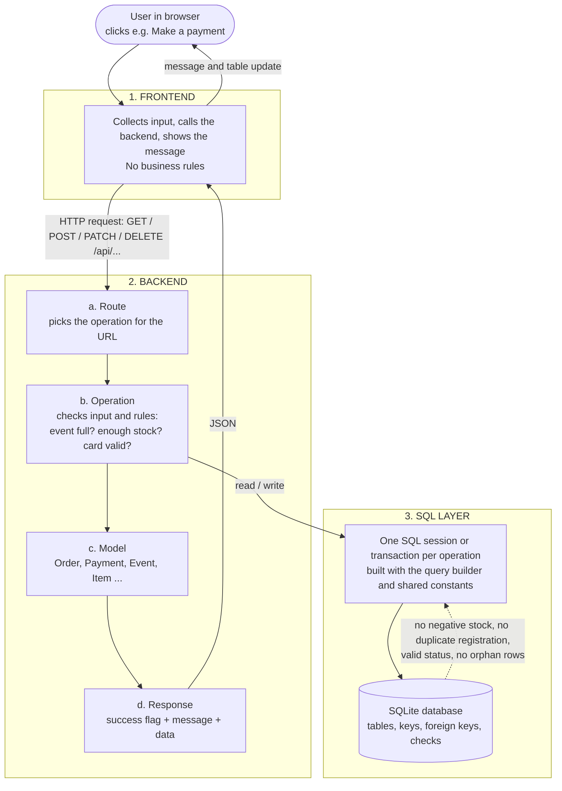
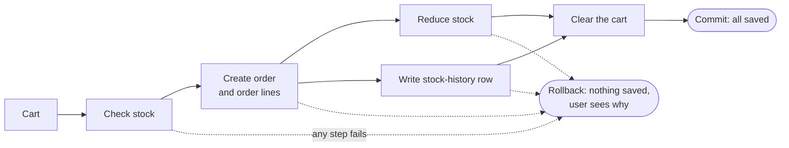
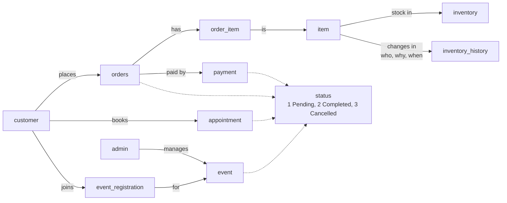

# BTM 495 Project

## Quick start

**Step 1. Clone the project**

```
git clone https://github.com/Humi852/BTM495_project.git
cd BTM495_project
```

**Step 2. Run the setup script (one line)**

It creates the Python environment (skipped if it already exists), starts the
local website, and opens it in your browser. Requires Python 3.10 or newer.

Windows:

```
setup.bat
```

macOS / Linux:

```
bash setup.sh
```

Press `Ctrl+C` in the terminal to stop the server. If the browser does not
open, go to `http://localhost:8765/`.

**Step 3. Try the features in the browser**

| Section on the page | What to try |
| --- | --- |
| Test profile login | Log in with `login@example.com` / `1234`. |
| Database structure | See all tables and row counts. `status` has 3 rows: Pending, Completed, Cancelled. Click **Refresh data** to reload. |
| Orders | Click **Make a payment** to create a $50 sample order. Use the edit and delete icons on a row, or **Remove all orders**. |
| Mock credit card | The form is prefilled with a valid test card. Click **Review payment** and confirm. Any other card number is declined. |
| Payment history | See paid payments. Use the edit and delete icons, or **Remove all payments**. |
| Inventory | Click **Save item** to add or update an item. Click the history icon to see stock changes (who, when, why). Use the delete icon to remove it. |
| Event registration | Click **Add sample event (limit 2)**, then register customer IDs until it is full. Duplicate and over-limit registrations are rejected. Unregister with the `🗑 #id` button. |

No real payment is made and card details are never stored.

## Run the tests

```
python -m unittest discover -s tests -p "test_*.py"
```

The last line should say `OK`. Warning and error log lines in the middle of
the run are expected. The tests use temporary databases, so they do not change
your data.

## Optional config

- Fresh database: stop the server, then delete `database/lpvr.db`.
- Another port: `setup.bat --port 8766` or `bash setup.sh --port 8766`.
- Command-line mock payment: `python main.py`.

## Project overview

A bike-shop website where customers and administrators manage profiles,
events, appointments, orders, payments, and inventory. It is written in Python
with SQLite as the single source of truth: every feature reads and writes the
database through the same path.



(Diagrams are Mermaid and render on GitHub. In VS Code, install the "Markdown
Preview Mermaid Support" extension to see them.)

## Project structure

| Folder / file | Purpose |
| --- | --- |
| `frontend/` | Website HTML, CSS, JavaScript |
| `backend/apis/` | Local website server and application operations (profiles, cart, orders, payments, inventory, events) |
| `backend/models/` | Python classes for users, items, carts, orders, payments, events, appointments |
| `backend/utils/` | SQLite query builder and transactions, validation, logging, responses, table/column/status constants |
| `database/` | `schema.sql` (tables), `sqlite_database.py` (creates and upgrades `lpvr.db`) |
| `tests/` | Website tests; `tests/unitTests/` has the unit tests |
| `setup.bat` / `setup.sh` | One-line setup and start |
| `run_local_website.py`, `main.py` | Start the website, run the command-line payment example |

Accounts: `createAccount` stores a PBKDF2 password hash, and `login` checks
Admin and Customer accounts by email and password. Passwords must be at least
eight characters (the local demo account `login@example.com` is the only
exception).

## Details

**Checkout.** All steps run in one transaction: either all are saved or none.



**Data model.** Events, appointments, orders, and payments share one `status`
table: `1 Pending`, `2 Completed`, `3 Cancelled` (see `StatusID` in
`backend/utils/constants.py`).

